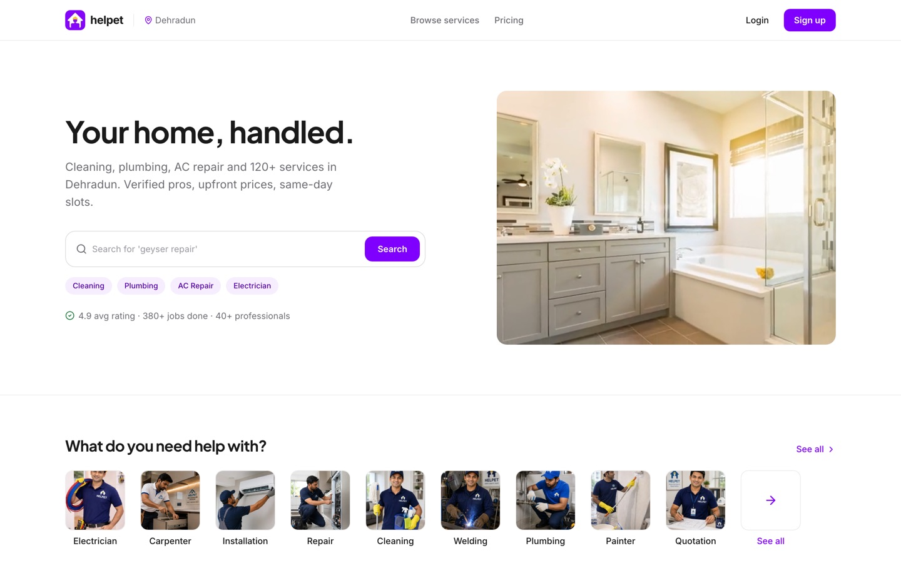
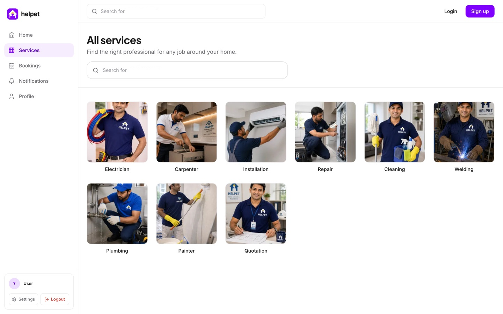
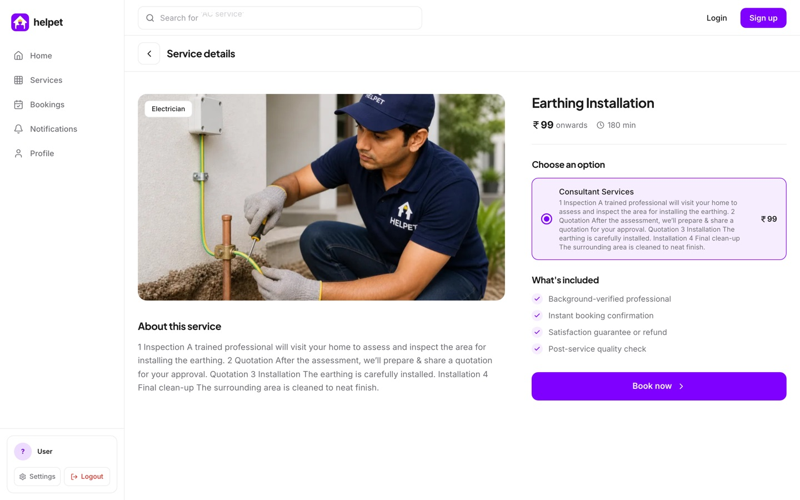
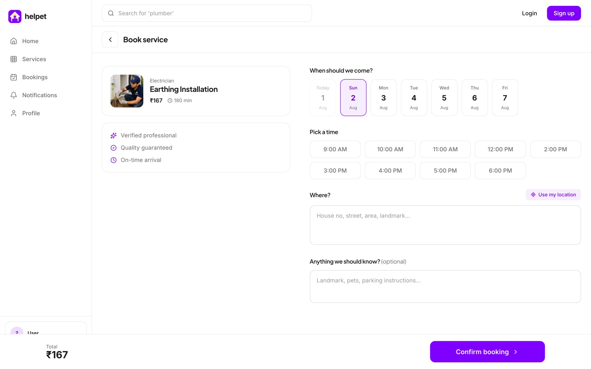
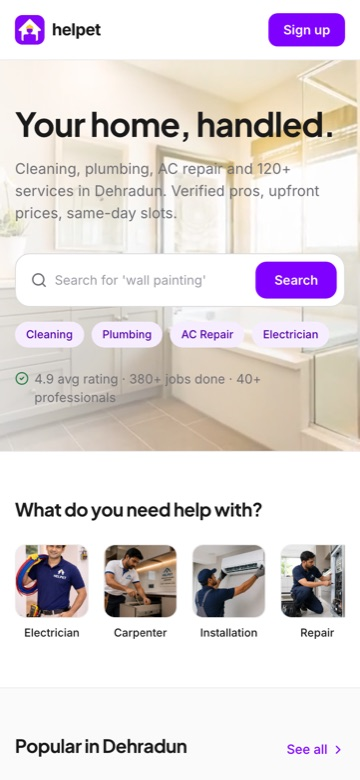
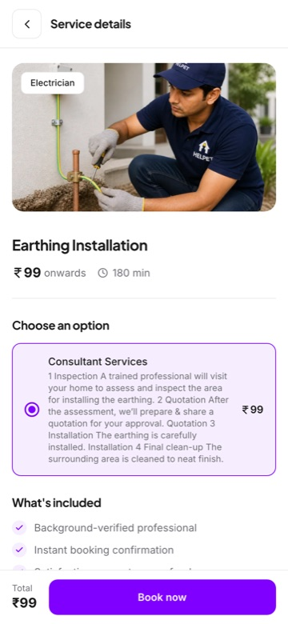
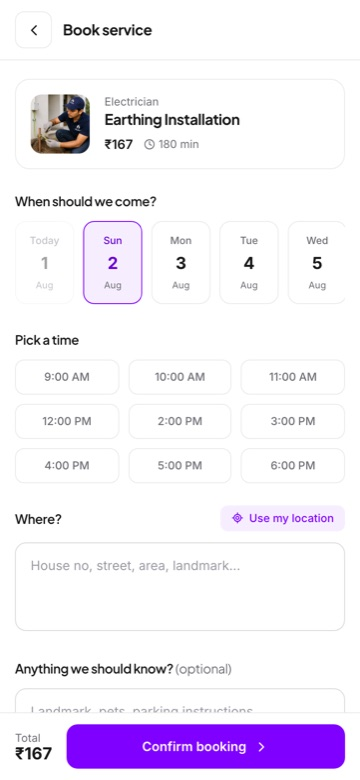
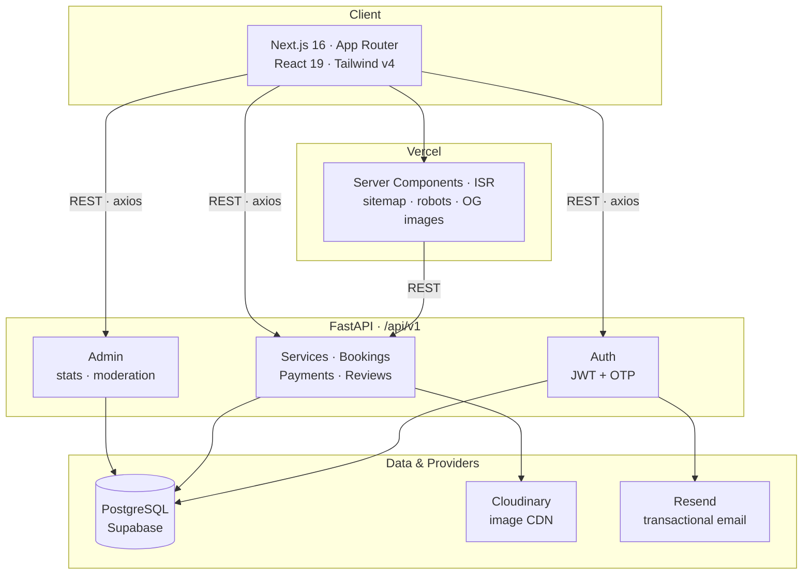

<div align="center">


# Helpet

**Dehradun's home services platform — book a verified professional in under a minute.**

[](https://helpet.in)
[](https://nextjs.org)
[](https://react.dev)
[](https://fastapi.tiangolo.com)
[](https://supabase.com)

[Live site](https://helpet.in) · [API docs](https://api.helpet.in/docs) · [Report an issue](https://github.com/surajkr97/Helpet/issues)

</div>

---

Helpet connects households in Dehradun with vetted professionals for cleaning, plumbing, electrical work, AC repair, carpentry and 120+ other services. Customers browse a curated catalogue, pick a slot, and pay after the job is done. Admins run the whole catalogue, booking pipeline and payment ledger from a built-in dashboard.

This repository is the full product: a **Next.js 16** storefront and admin panel, a **FastAPI** REST backend, and a **PostgreSQL** database.



<table>
<tr>
<td width="50%"></td>
<td width="50%"></td>
</tr>
<tr>
<td align="center"><sub><b>Catalogue</b> — every category, searchable</sub></td>
<td align="center"><sub><b>Service detail</b> — options, pricing, what's included</sub></td>
</tr>
</table>



<p align="center"><sub><b>Booking</b> — 7-day slot picker, geolocated address, and a running total that already includes the platform fee</sub></p>

<table>
<tr>
<td width="33%"></td>
<td width="33%"></td>
<td width="33%"></td>
</tr>
<tr>
<td colspan="3" align="center"><sub>Mobile-first throughout — the same flows at 390&nbsp;px</sub></td>
</tr>
</table>

---

## Highlights

| Feature | What it does |
| ------- | ------------ |
| 🔐 **Passwordless-first auth** | Email OTP login via Resend, JWT sessions, and password reset — with role-based access for customers, providers and admins |
| 🗂 **Deep service catalogue**  | Categories → services → sub-services, each with its own pricing, discount and platform fee, reorderable by drag-and-drop |
| 📅 **Real booking flow**       | 7-day slot picker that hides past times, one-tap address fill from device geolocation, and notes per booking |
| 💸 **Transparent pricing**     | Platform fee computed server-side and folded into the booking total, so the quote a customer sees is the amount that is recorded |
| ⭐ **Reviews & notifications** | Ratings gated on completed bookings the reviewer actually owns, one per booking, plus an in-app notification feed |
| 🛠 **Admin dashboard**         | Manage users, services, categories, bookings and payments with pagination and status controls |
| 🖼 **Runtime OG images**       | Every page renders its own 1200×630 social/search thumbnail via `next/og`, using the real service photo when one exists |
| 🔎 **SEO built in**            | JSON-LD (`LocalBusiness`, `Organization`, `WebSite`, `Breadcrumb`, `Service`), dynamic sitemap with image extensions, and `robots.txt` |

---

## Architecture



---

## Tech stack

| Layer        | Choice                                                                 |
| ------------ | ---------------------------------------------------------------------- |
| Frontend     | Next.js 16 (App Router, Turbopack), React 19, TypeScript 5             |
| Styling      | Tailwind CSS v4, Framer Motion, Lucide icons                           |
| Backend      | FastAPI, SQLAlchemy, Alembic, Pydantic v2                              |
| Database     | PostgreSQL (Supabase)                                                  |
| Auth         | JWT (`python-jose`), bcrypt via `passlib`, email OTP                   |
| Media        | Cloudinary, with `f_auto,q_auto` transforms applied at request time    |
| Email        | Resend                                                                 |
| Analytics    | Microsoft Clarity                                                      |
| Hosting      | Vercel (frontend) · containerised FastAPI (backend)                    |

---

## Quick start

**Prerequisites** — Node 20+, Python 3.13, and a PostgreSQL database.

### 1. Backend

```bash
cd backend
python -m venv .venv && source .venv/bin/activate
pip install -r requirements.txt

# create backend/.env — see "Environment variables" below
alembic upgrade head
python seed.py            # optional: loads demo catalogue + users

uvicorn app.main:app --reload
```

API runs at **http://localhost:8000** — interactive docs at **/docs**, ReDoc at **/redoc**.

### 2. Frontend

```bash
cd frontend
npm install

# create frontend/.env.local — see "Environment variables" below
npm run dev
```

App runs at **http://localhost:3000**.

---

<details>
<summary><b>Environment variables</b></summary>

<br>

**`backend/.env`**

| Variable | Required | Notes |
| -------- | :------: | ----- |
| `DATABASE_URL` | ✅ | PostgreSQL connection string |
| `SECRET_KEY` | ✅ | JWT signing secret |
| `APP_NAME` | — | Defaults to `Helpet` |
| `DEBUG` | — | Defaults to `true` |
| `ACCESS_TOKEN_EXPIRE_MINUTES` | — | Defaults to `20160` (14 days) |
| `RESEND_API_KEY` | — | Omit in development — OTPs print to the console |
| `RESEND_FROM_EMAIL` | — | Defaults to the Resend onboarding sender |
| `CLOUDINARY_CLOUD_NAME` | — | Required only for image uploads |
| `CLOUDINARY_API_KEY` | — | Required only for image uploads |
| `CLOUDINARY_API_SECRET` | — | Required only for image uploads |
| `FRONTEND_URL` | — | Extra CORS origins, comma-separated |

**`frontend/.env.local`**

| Variable | Required | Notes |
| -------- | :------: | ----- |
| `NEXT_PUBLIC_API_URL` | ✅ | e.g. `http://localhost:8000/api/v1` |
| `NEXT_PUBLIC_APP_URL` | ✅ | Canonical site URL — drives `metadataBase`, sitemap and JSON-LD |
| `NEXT_PUBLIC_CLARITY_ID` | — | Analytics; omitted in development |

</details>

<details>
<summary><b>API reference</b></summary>

<br>

All routes are prefixed with `/api/v1`.

**Auth** — `/auth`

| Method | Path | Description |
| ------ | ---- | ----------- |
| `POST` | `/register` | Create an account |
| `POST` | `/login` | Password login → JWT |
| `GET`  | `/me` | Current user from token |
| `POST` | `/otp/send` | Send a one-time code |
| `POST` | `/otp/verify-login` | Exchange OTP for JWT |
| `POST` | `/otp/verify-email` | Confirm email ownership |
| `POST` | `/password-reset/request` · `/password-reset/confirm` | Reset flow |

**Services** — `/services`

| Method | Path | Description |
| ------ | ---- | ----------- |
| `GET` | `/categories` · `/` · `/{id}` | Public catalogue reads |
| `POST` `PUT` `DELETE` | `/categories`, `/`, `/{id}` | Admin catalogue writes |
| `PUT` | `/categories/reorder` · `/reorder` | Persist drag-and-drop order |
| `POST` `PUT` `DELETE` | `/{id}/sub-services/…` | Manage sub-services |

**Bookings** — `/bookings`

| Method | Path | Description |
| ------ | ---- | ----------- |
| `POST` | `/` | Create a booking (server computes the platform fee) |
| `GET` | `/my` · `/{id}` | Customer's bookings |
| `PUT` `DELETE` | `/{id}` | Update or cancel |
| `GET` | `/` | All bookings (admin) |

**Payments** — `/payments` · **Reviews** — `/reviews` · **Notifications** — `/notifications`

| Method | Path | Description |
| ------ | ---- | ----------- |
| `POST` | `/payments/offline` | Confirm a COD/UPI booking |
| `GET` | `/payments/my` · `/payments/{id}` | Payment history |
| `POST` | `/reviews/` | Review a completed booking |
| `GET` | `/reviews/my` · `/reviews/provider/{id}` | Read reviews |
| `GET` `PUT` | `/notifications/my` · `/{id}/read` · `/read-all` | Notification feed |

**Admin** — `/admin`

| Method | Path | Description |
| ------ | ---- | ----------- |
| `GET` | `/stats` | Dashboard counters |
| `GET` `PUT` `DELETE` | `/users…` | Paginated users, status and role changes |
| `GET` `PUT` | `/bookings…` · `/payments…` | Paginated pipelines with status updates |

</details>

---

## Project structure

```
Helpet/
├── backend/
│   ├── app/
│   │   ├── api/v1/endpoints/   # auth · services · bookings · payments · reviews · admin
│   │   ├── core/               # config · security · email · dependencies
│   │   ├── db/                 # engine · session · base
│   │   ├── models/             # SQLAlchemy tables
│   │   ├── schemas/            # Pydantic request/response contracts
│   │   └── services/           # auth · booking · notification · storage
│   ├── alembic/versions/       # migrations
│   ├── tests/                  # pytest suite
│   └── seed.py                 # demo data
│
└── frontend/
    ├── src/app/
    │   ├── (public pages)      # home · categories · services · book · payment
    │   ├── admin/              # dashboard · users · services · bookings · payments
    │   ├── opengraph-image.tsx # runtime social/search thumbnails
    │   ├── sitemap.ts          # dynamic sitemap with image extensions
    │   └── robots.ts
    ├── src/components/         # shared UI
    └── src/lib/                # api client · og-image · seo-data · image resolver
```

---

## Testing

The backend ships a `pytest` suite covering auth, services, bookings, payments, reviews, notifications and admin routes. Tests run against a dedicated `helpet_test` database — created and torn down per session, never your development data.

```bash
cd backend
source .venv/bin/activate
pytest
```

---

## Deployment

The frontend deploys to **Vercel**, wired to this repository — every pull request gets its own preview deployment, and merges to `master` ship to production. The backend runs as a container (`Dockerfile` + `start.sh`), applying migrations on boot before serving with Gunicorn/Uvicorn workers.

---

## License

No open-source licence is granted. © Helpet India — all rights reserved.

<div align="center">
<br>
<sub>Built in Dehradun, Uttarakhand 🏔</sub>
</div>
